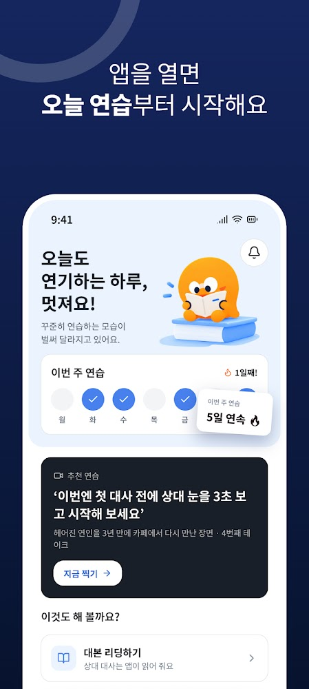
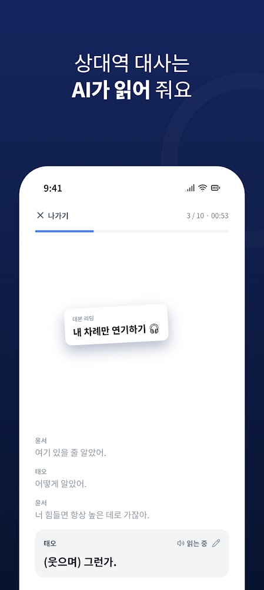
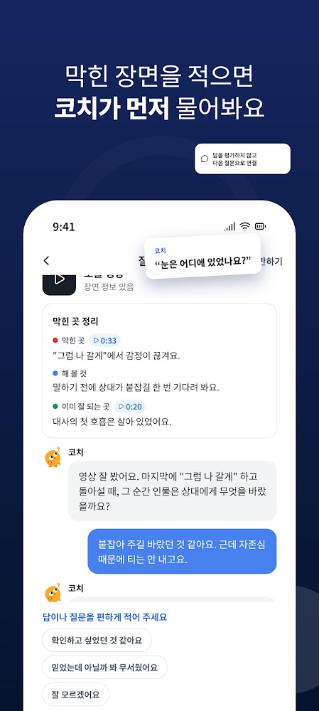
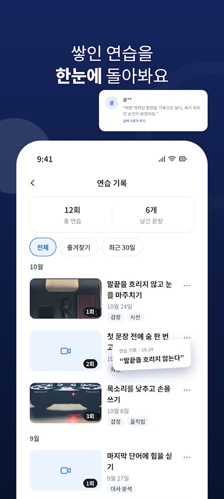
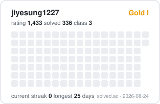

# 류지성

LLM이 들어간 앱을 만듭니다. 지금은 배우들이 쓰는 연기 연습 앱 [Acttub](https://acttub.com)에서 코칭 AI 설계와 앱 개발을 맡고 있습니다.

고등학교 때 안드로이드 앱으로 개발을 시작했고, 대학에 와서 모델 학습과 강화학습을 공부했습니다. AI 엔지니어로 일하는 게 목표입니다.

- 소프트웨어 마에스트로 17기 (팀 로딩중)
- 세종대학교 컴퓨터공학과 2학년
- 선린인터넷고등학교 소프트웨어과 졸업

## Acttub

연기 영상을 올리면 AI 코치가 장면을 보고 질문을 던지고, 대본을 넣으면 상대역 대사를 읽어 주는 앱입니다. 셋이서 만들어 Google Play와 App Store에 출시했고 지금도 운영하고 있습니다.

  
  
  
  

저는 앱과 웹 화면, 코칭과 대본 리딩의 AI 설계, 스토어 출시를 맡았습니다.

- 처음에는 긴 지시문 하나에 코칭 대화를 통째로 맡겼는데, 같은 질문을 네다섯 번씩 되묻는 문제가 있었습니다. 배우의 말을 분류하는 모델과 다음 진행을 정하는 코드 규칙으로 나눠서 고쳤습니다.
- 프롬프트를 바꿀 때마다 고정된 사례 16개로 대화를 다시 만들어 보고, 반복 질문이나 근거 없는 관찰 같은 규칙 위반을 자동으로 셉니다. 같은 입력으로 비교해 보니 프롬프트를 두 번 고치는 동안 위반이 44건에서 13건으로 줄었습니다.
- 대본 리딩에서는 상대역 음성을 기기 안에서 합성하고, 음성 인식으로 내 대사가 끝난 걸 알아채 다음 줄로 넘어갑니다.
- 앱 화면을 전부 다시 만든 뒤, 가입하고 72시간 안에 첫 연습을 시작하는 비율이 40.2%에서 62.9%로 올랐습니다.

2026년 11월 8일 기준으로 가입 3,435계정, 대본 리딩 5,979회, 코칭 대화 1,149건입니다.

[acttub.com](https://acttub.com) · [Google Play](https://play.google.com/store/apps/details?id=com.acttub.app) · [App Store](https://apps.apple.com/kr/app/acttub/id6793056855) · [저장소](https://github.com/acttub/acttub-platform)

## 다른 프로젝트

| 프로젝트 | 설명 | 기술 | 연도 |
|---|---|---|---|
| [상대역 리허설](https://github.com/ryujisung/read_tts) | 대본 파일을 넣고 내 배역을 고르면 나머지 대사를 읽어 주는 웹입니다. 대본과 목소리는 브라우저 밖으로 나가지 않습니다. | Next.js, TypeScript, ONNX Runtime | 2026 |
| [zibro](https://github.com/ryujisung/zibro) | AI와 대화하는 심리상담 채팅에 커뮤니티 게시판을 붙인 안드로이드 앱입니다. 언어 모델 서버를 따로 띄워 두고 앱에서 불렀습니다. | Kotlin, Retrofit, Room | 2024 |
| [도담도담](https://github.com/ryujisung/dodamdodam) | 가족이 매일 같은 질문을 받고 서로의 답을 보는 안드로이드 앱입니다. | Kotlin, Retrofit | 2023 |
| [레츠미트](https://github.com/ryujisung/let-s-meet) | 친구들 일정을 보고 약속을 잡는 안드로이드 앱입니다. | Kotlin | 2023 |
| [GreenUp](https://github.com/ryujisung/GreenUp) | 식품 바코드를 찍으면 친환경 제품 정보를 보여 주는 안드로이드 앱입니다. | Kotlin, ZXing, Retrofit | 2023 |
| [Membeder](https://github.com/ryujisung/Membeder-Android) | 대회에 같이 나갈 팀원을 모으고 일정과 공지를 관리하는 안드로이드 앱입니다. 선린 디지털 콘텐츠 개발대회에서 동상을 받았습니다. | Kotlin, Firebase | 2022 |

## 공부하면서 해 본 것

- HuggingFace로 LLM을 LoRA 파인튜닝했습니다. bitsandbytes 4bit, 8bit 양자화 상태에서 학습시키고 데이터와 학습 설정에 따라 출력이 어떻게 달라지는지 비교했습니다.
- Atari Breakout을 푸는 DQN 에이전트를 Python과 Unity로 만들었습니다.
- CNN으로 쓰레기 분류 웹과 수화 인식 서비스를 만들었습니다.
- 표정과 오디오(CLAP) 임베딩으로 비슷한 연기 영상을 찾는 검색을 [실험](https://github.com/acttub/acttub-ai-embedding)했습니다.

## 기술

지금 주로 쓰는 것

  
  
  
  
  
  

써 본 것

  
  
  
  
  
  
  

## 수상과 이력

- 2025 세종대학교 SW코딩 경시대회 2등
- 2023 선린인터넷고등학교 알고리즘 페스티벌 은상
- 2022 선린 디지털 콘텐츠 개발대회 동상
- 세종대학교 컴퓨터공학과 학과 수석, 성적 우수 장학금
- 정보처리기능사

## 알고리즘

<a href="https://solved.ac/profile/jiyesung1227">
  <picture>
    <source media="(prefers-color-scheme: dark)" srcset="badges/solved-dark.svg"/>
    
  </picture>
</a>

풀이 코드는 [boj](https://github.com/ryujisung/boj) 저장소에 있습니다.
